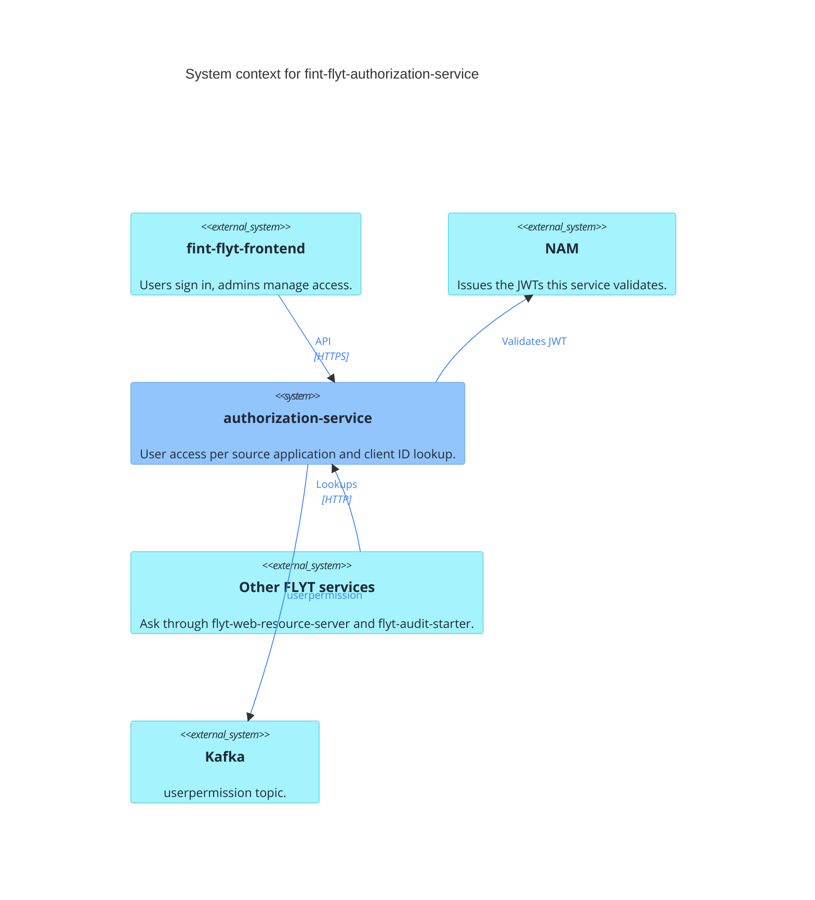
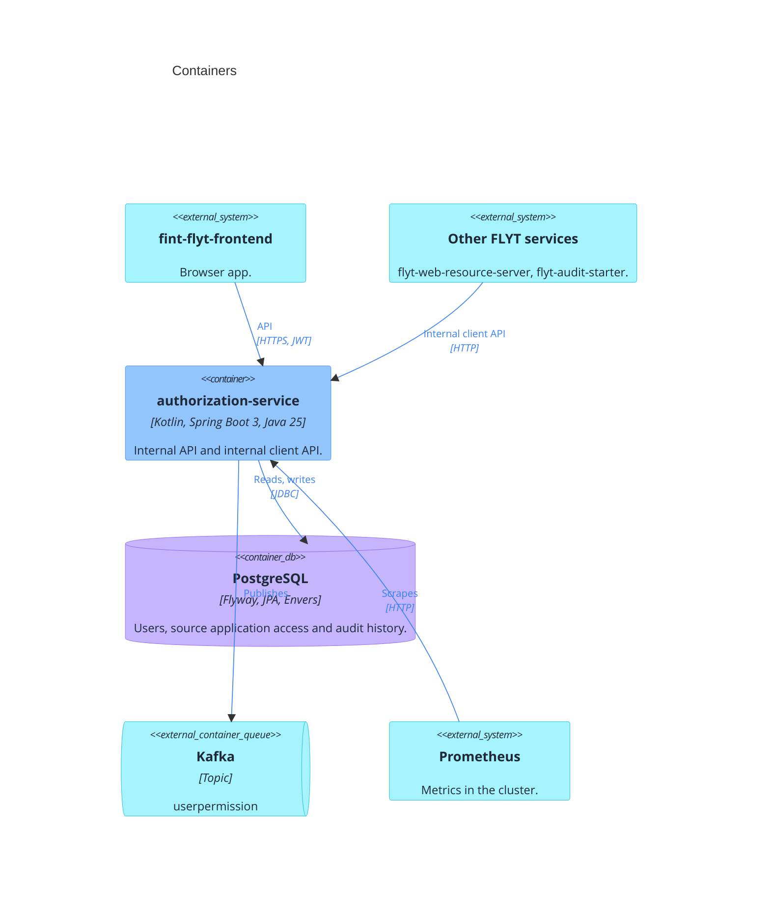
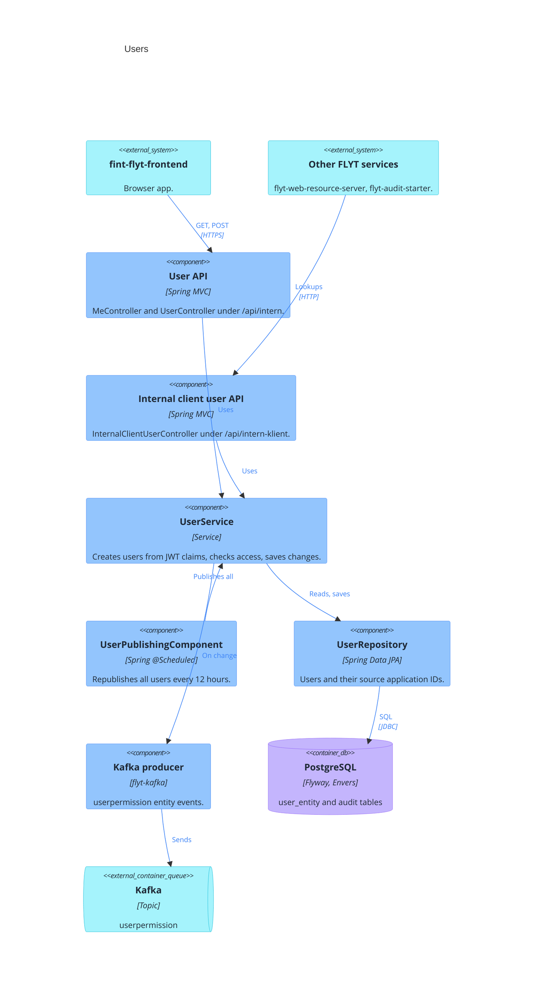
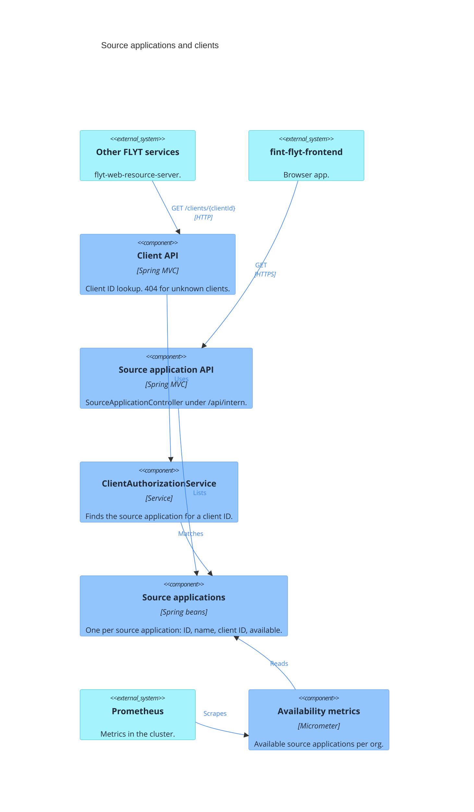

# Architecture

C4 level 1 to 3 for fint-flyt-authorization-service. Blue is this service, purple is the database,
turquoise is external.

## C4 level 1: System context

Authorization-service decides which source applications a FLYT user may see, and which source
application an external client ID belongs to. The other FLYT services ask it through
flyt-web-resource-server.

- **Users** sign in through fint-flyt-frontend. On first sign-in the service creates the user from
  the JWT, if the token has a permitted app role. Admins get access to all source applications.
- **Other FLYT services** call `/api/intern-klient/authorization` with a token for
  `fint-flyt-authorization-oauth2-client`, the shared client for internal calls:
  - flyt-web-resource-server checks which source applications a user may see, and which source
    application the client ID of an incoming token belongs to.
  - flyt-audit-starter looks up the display names of users for audit history.
- **Kafka:** user permissions are still published as `userpermission` entity events. The only
  consumer was the archived fint-flyt-resource-server, so the topic has no consumers now.

## C4 level 2: Containers

One Spring Boot application and one PostgreSQL database.

- The ingress only routes `/api/intern/authorization`. The internal client API, Swagger UI,
  OpenAPI and Actuator are only reachable inside the cluster.
- The database is the shared `fint-flyt` database, with Flyway migrations in this repo.

## C4 level 3: Components

### Users

- `MeController` returns the signed-in user and creates it on first sign-in. `UserController` is
  for admins: list users and set their source applications in bulk.
- `InternalClientUserController` looks up users by `objectIdentifier` and answers
  `actions/authorize-source-applications`, which flyt-web-resource-server calls for every request
  that needs user access.
- Changes to `user_entity` are kept in Envers audit tables with the actor from flyt-audit-starter.
  `LocalActorNameLookupConfig` looks names up in the same database instead of over HTTP.

### Source applications and clients

- `InternalClientAuthorizationController` is the client API. `SourceApplicationAvailabilityMetrics`
  publishes the availability metrics.
- Each source application (Acos, eGrunnerverv, Digisak, Vigo, Altinn, HMSReg, eApply, fskyss,
  ISY Graving, SiDE) is a bean with a fixed ID. The client ID comes from the source application's
  OAuth client secret in the namespace (`fint.flyt.<name>.sso.client-id`), and
  `fint.flyt.<name>.available` says whether it is enabled for the org.
- flyt-web-resource-server calls `/clients/{clientId}` for incoming tokens on the external API and
  caches the answer for one minute. It replaced the `authorization` request/reply topic
  (FFS-2398, removed in FFS-2400).
